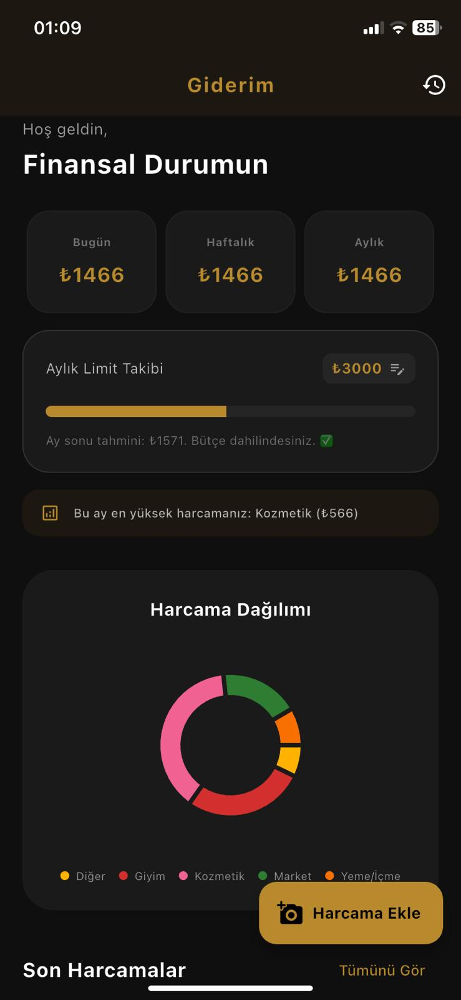
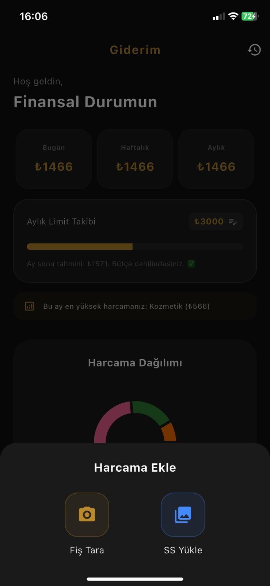

# Giderim - Smart Personal Finance & Expense Analytics

Giderim is a mobile application developed with Flutter and Dart, focused on financial literacy through automated expense tracking and data visualization. The project implements custom algorithms to transform unstructured receipt data into actionable financial insights.

---

## Application Showcase

  
  

---

## Technical Logic & Data Engineering

The application incorporates specialized logic to handle complex data extraction and analytical projections:

* **Bottom-Up OCR Scanning:** A custom algorithm designed to accurately identify the total amount by scanning receipt text from bottom-to-top, minimizing errors from irrelevant numerical data.
* **Predictive Budget Projection:** An analytical model that estimates month-end spending based on the user's current spending velocity and historical patterns.
* **Merchant Identification and Filtering:** A system using an extensive ignore-list to prevent technical receipt terms (e.g., "Mali Degeri Yoktur") from being misidentified as merchant names.
* **Automated Categorization:** Mapping logic that assigns expenses to categories based on merchant name patterns and keyword matching.

---

## Technical Stack

* **Framework:** Flutter and Dart for cross-platform mobile development.
* **OCR Engine:** Google ML Kit for Optical Character Recognition.
* **Persistence:** SQLite for local relational data storage and SharedPreferences for persistent settings.
* **Visualization:** FL Chart library for dynamic data representation.

---

## Confidentiality & Usage Note

* **Source Code:** The source code for this project is private to protect intellectual property.
* **Test Data:** Screenshots contain anonymized or placeholder data. Real user data and specific transaction histories are withheld for privacy and data protection compliance.

---

> Note: This repository serves as a technical showcase for the application's architecture and UI/UX design.
